  
  
  
  

Computer Engineer building end-to-end data and AI systems, from ingestion and processing to model development and reliable deployment. I bring MLOps and DevOps practice, cloud-native tooling and High-Performance Computing to make them reproducible and production-ready, and I teach what I learn.

## Building now: galadyas

**Open-source projects, built in public.** Technology works best when it serves people: their time, their privacy, their trust. [Explore the series →](https://github.com/98-Anas/galadyas)

<table>
<tr>
<td width="50%" valign="top">

 <b><a href="https://github.com/98-Anas/galadyas_terminal">galadyas_terminal</a></b> 
One terminal workspace for Windows and Linux: split panes, autocomplete, a task manager with GPU usage and offline command toolkits. 
Python · open source · under development
</td>
<td width="50%" valign="top">

 <b><a href="https://github.com/98-Anas/galadyas_visionary">galadyas_visionary</a></b> 
A desktop studio for polished launch, report and lesson videos from templates, rendered on your own machine. 
Python · open source · under development
</td>
</tr>
</table>

## Selected work

| Project | What I built | Stack |
|---|---|---|
| [**FlaskOps**](https://github.com/98-Anas/AutoFlaskops_on_HA_K8s) | Cloud-native infrastructure for a Flask application on a highly available Kubernetes cluster, with Grafana observability | Kubernetes · Terraform · Ansible · Grafana |
| [**HPC on single-board computers**](https://github.com/98-Anas/astro_image_star_counter) | A two-node Raspberry Pi 4 cluster counting stars in high-resolution Hubble images with distributed processing | Python · MPI · OpenCV |
| [**End-to-end lane keeping**](https://www.linkedin.com/posts/anas-ayman98_autonomousdriving-deeplearning-lanekeeping-activity-7212031349732368385-gzQ6) | Graduation project: a behavioral-cloning model trained on synthetic data and tested on a 1/10-scale RC car | Deep learning · computer vision |
| [**AWS landing zone**](https://github.com/98-Anas/test_aws_land_zone) | A Free Tier landing zone provisioned entirely through GitHub Actions pipelines | AWS · Terraform · GitHub Actions |
| [**DevSecOps CI/CD**](https://github.com/98-Anas/spring_boot_cicd_app) | Build, security scanning and deployment pipelines for containerized services | GitLab CI/CD · Docker |

## Now

- **Data Analyst**, Nile University · since June 2026
- **Physical AI Instructor**, San3a Tech · part time, since March 2026
- **Creator, [NU Linux Bootcamp](https://github.com/98-Anas/NU_LinuxBootcamp)**: practical Linux, networking and Docker as the foundation for embedded, cloud, DevOps and HPC careers

## Skills

| Area | Tools |
|---|---|
| Programming | Python · Bash · C++ · Lua · SQL |
| DevOps & Cloud | Docker · Kubernetes · Terraform · Ansible · Kustomize · GitHub Actions · GitLab CI/CD · GitOps · AWS · Google Cloud |
| HPC & Monitoring | Slurm · Bright Cluster Manager · EasyBuild · MPI · OpenMP · Prometheus · Grafana |
| Machine Learning & AI | PyTorch · TensorFlow · Keras · TensorFlow Lite · scikit-learn · OpenCV · TinyML |
| Data | Pandas · NumPy · Matplotlib · Seaborn · Power BI · SQL Server · Jupyter |
| Systems & Hardware | Linux administration · networking · REST APIs · Raspberry Pi · NVIDIA Jetson · ESP32 |

<b>Certifications</b> (11)

 

- [Introduction to Project Management](https://www.coursera.org/account/accomplishments/verify/5K58EOZNH23Q) · IBM, Coursera
- [Delivering Quality Work with Agility](https://www.coursera.org/account/accomplishments/verify/NIE0DBX8PFPN) · IBM, Coursera
- [Docker Foundations Professional Certificate](https://www.linkedin.com/learning/certificates/08255a7ba2ddf55bddad0fa4e98e948bfaea36a2ab0c75f83973a7a0fbee59e1) · Docker, LinkedIn Learning
- [LFS162: Introduction to DevOps and Site Reliability Engineering](https://www.credly.com/badges/b01dc870-cd02-475b-9a37-2bd930bd33e8) · The Linux Foundation
- [LFS101: Introduction to Linux](https://www.credly.com/badges/67fe4753-ac6f-4367-b226-711eb14e330c) · The Linux Foundation
- [DevOps Fundamentals: From Zero to Practical Overview](https://www.udemy.com/certificate/UC-d619783b-acb4-4fe5-8624-5534b3a9a623/) · Udemy
- Introduction to High Performance Computing · ITI Mahara Tech
- Open Source Summit + Embedded Linux Conference NA 2020 · certificate of attendance, The Linux Foundation
- [AWS Academy Graduate: Cloud Architecture](https://www.credly.com/badges/ad4e30b4-67a2-4e4e-9022-0cbf83b10a80)
- [AWS Academy Graduate: Cloud Foundations](https://www.credly.com/badges/ca91901b-e4cc-4a9d-bc94-413ece20e320)
- [Linux Unhatched](https://www.credly.com/badges/2c9f8880-42ae-465f-b5ef-bcda1bf986dc) · Cisco Networking Academy

<b>Currently learning</b>

 

- [IBM IT Project Manager Professional Certificate](https://www.coursera.org/professional-certificates/ibm-it-project-manager) · Coursera, in progress
- [DataCamp certification](https://www.datacamp.com/certification) · in progress
- [Claude courses](https://academy.claude.com/courses) · Anthropic Academy, in progress
- Self-study: [Corey Schafer (Python)](https://www.youtube.com/@coreyms/playlists), [Hesham Asem (machine learning and deep learning, Arabic)](https://www.youtube.com/@HeshamAsem/playlists), [Elzero Web School (programming, Arabic)](https://www.youtube.com/@ElzeroWebSchool/playlists)

